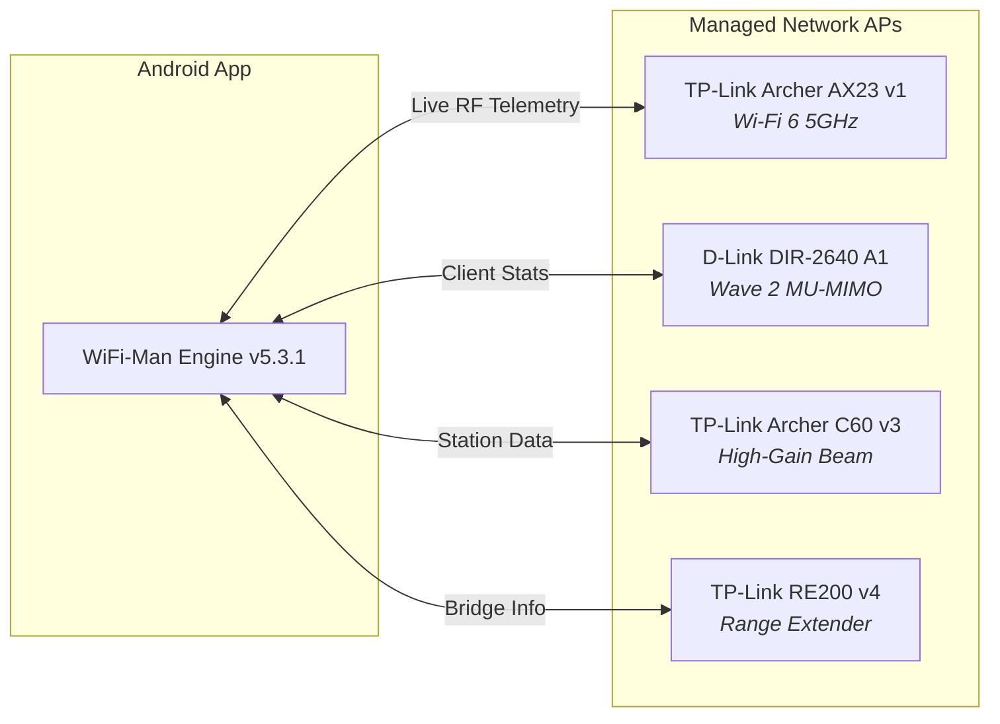

# 🗂️ WiFi-Man
### The Intelligent Local Network Dashboard & SMB Suite for Android

  

 

---

## 🚀 Quick Download & Deploy

<table>
  <tr>
    <th width="35%">Asset</th>
    <th width="40%">Description</th>
    <th width="25%">Action</th>
  </tr>
  <tr>
    <td><b>📦 app-debug.apk</b></td>
    <td>Compiled signed APK payload (v5.3.1)</td>
    <td><a href="https://raw.githubusercontent.com/abhijit-108/wifi-man/main/app-debug.apk"><b>📥 Download Direct APK</b></a></td>
  </tr>
  <tr>
    <td><b>🧬 Source Archive (.7z)</b></td>
    <td>Complete Android Studio project tree and assets</td>
    <td><a href="https://raw.githubusercontent.com/abhijit-108/wifi-man/main/Android%20Studio%20Wifi%20Man.7z"><b>📦 Download Source (.7z)</b></a></td>
  </tr>
  <tr>
    <td><b>📄 version.json</b></td>
    <td>Live release manifest and update metadata</td>
    <td><a href="https://raw.githubusercontent.com/abhijit-108/wifi-man/main/version.json"><b>🔍 View Manifest</b></a></td>
  </tr>
</table>

---

## ✨ Key Features

<table>
  <tr>
    <td width="50%" valign="top">
      <h3>📶 Live Station Intelligence</h3>
      
Instantaneous scanning of every authenticated hardware station. Displays real-time signal power (<code>-dBm</code>), IP mapping, device hostnames, and dynamic live MB/GB throughput telemetry.

      ⚡ Refreshed every 2000ms
    </td>
    <td width="50%" valign="top">
      <h3>🛡️ 15s Foreground Sentinel</h3>
      
Low-overhead background daemon polling router association tables continuously. Issues high-priority heads-up system banners on new device connections with lifetime join counts.

      🛡️ Persistent with boot auto-revival
    </td>
  </tr>
  <tr>
    <td width="50%" valign="top">
      <h3>🎨 Cyber Dark Glassmorphism</h3>
      
Engineered with deep space navy (<code>#090C15</code>) and slate surface cards (<code>#111625</code>). Features a floating bottom navigation bar with active neon purple capsule indicators.

      ✨ Pure AMOLED zero-strain palette
    </td>
    <td width="50%" valign="top">
      <h3>📁 Compose SMB File Streamer</h3>
      
Native Samba protocol explorer built with Jetpack Compose. Effortlessly browse and stream high-bitrate Movies and Anime directly from router-attached USB drives with zero stutter.

      🎬 Leak-proof handle pooling
    </td>
  </tr>
  <tr>
    <td width="50%" valign="top">
      <h3>🕹️ Scheduled Game Mode</h3>
      
Auto-activates during peak gaming hours (10:00 PM – 12:30 AM). Maximizes network visibility and immediately flags bandwidth-heavy streaming devices.

      🎮 Low-ping session optimizer
    </td>
    <td width="50%" valign="top">
      <h3>🔄 In-App OTA Updater</h3>
      
Direct GitHub release checking powered by <code>version.json</code>. Delivers instant changelog cards with one-tap background APK downloads.

      📦 Frictionless updates
    </td>
  </tr>
</table>

---

## 🧩 Hardware Topology

---

## 📋 Changelog

<table>
  <tr>
    <th colspan="2" align="left">
      🚀 <b>v5.3.1</b> &nbsp;·&nbsp; <i>July 27, 2026</i>
      
        
      
    </th>
  </tr>
  <tr>
    <td width="50%" valign="top">
      <b>🎨 Permanent Cyber Dark UI</b>
      
Enforced deep space navy (<code>#090C15</code>) and dark slate surfaces (<code>#111625</code>) across both XML Dashboard and SMB Compose views, preventing blinding white mode overrides.

      <b>🪪 Cyber Station Card Redesign</b>
      
Redesigned station cards with vibrant avatar chips (purple, gold, indigo), crisp dark borders, and dynamic superscript RSSI power text (<code>-57 dBm</code>) next to the header title.

    </td>
    <td width="50%" valign="top">
      <b>🎛️ Horizontal Monitor Widget</b>
      
Reconstructed the Background Wi-Fi Monitor widget into a clean, horizontal card row with real-time status indicators and custom purple toggle styling.

      <b>💊 Floating Capsule Navigation</b>
      
Built a floating dark container for bottom navigation featuring an active neon purple capsule indicator (<code>#261B4E</code> / <code>#A855F7</code>) and improved MB/GB contrast.

    </td>
  </tr>
</table>

<table>
  <tr>
    <th colspan="2" align="left">
      ⚡ <b>v5.2.1</b> &nbsp;·&nbsp; <i>July 26, 2026</i>
      
        
      
    </th>
  </tr>
  <tr>
    <td width="50%" valign="top">
      <b>🛡️ 15s Foreground Sentinel</b>
      
Added a persistent background Wi-Fi Monitor Foreground Service that continuously polls router station tables every 15s even when the app is closed, with automatic boot recovery.

    </td>
    <td width="50%" valign="top">
      <b>🔔 Heads-Up Connection Alerts</b>
      
Added high-priority system alert banners formatted to <code>[Device] Connected | Total X Times</code> using live system log parsing (<code>calculateConnectCountFromLogs</code>).

    </td>
  </tr>
</table>

<table>
  <tr>
    <th colspan="2" align="left">
      📁 <b>v5.0.2</b> &nbsp;·&nbsp; <i>June 24, 2026</i>
      
        
      
    </th>
  </tr>
  <tr>
    <td width="50%" valign="top">
      <b>🎬 SMB Files Jetpack Compose Hub</b>
      
Replaced the legacy router tab with a native SMB file browser featuring dynamic routing for Dashboard, Movies, and Anime folders.

    </td>
    <td width="50%" valign="top">
      <b>🪟 Glassmorphic Sidebar & Stability</b>
      
Introduced a glassmorphic sidebar showing real-time WiFi Channel stats and fixed SMB explorer crashes from stale DiskShare handles.

    </td>
  </tr>
</table>

<b>View Earlier Release History (v5.0.1 – v4.0.2)</b>

 

| Version | Date | Highlights |
| :--- | :--- | :--- |
| **v5.0.1** | June 18, 2026 | Added dynamic "New Version Available" badge in sidebar; removed redundant data clear actions. |
| **v4.0.7** | April 25, 2026 | Added new router hostname resolution and updated launch splash screen credits. |
| **v4.0.5** | March 31, 2026 | Added one-tap "Reupdate" button directly in the glassmorphic sidebar. |
| **v4.0.4** | March 25, 2026 | Introduced client device grouping, slicker menu bar, and restructured settings menu. |
| **v4.0.2** | March 22, 2026 | Fixed device sorting criteria and refreshed station list animations. |

---

  Crafted by <b>Abhijit</b> • Powered by Jetpack Compose & Cyber Dark Architecture

