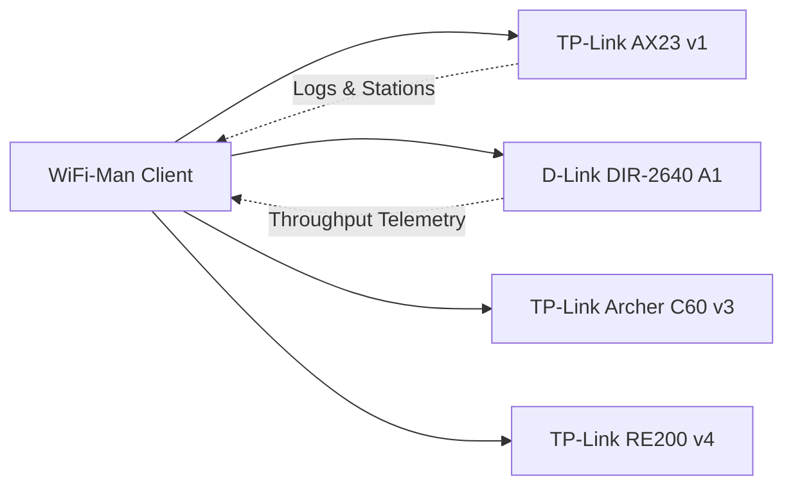

# 🗂️ WiFi-Man
### The Intelligent Local Network Dashboard & SMB Suite for Android

  

 

---

## 🍱 Feature Grid

<table>
  <tr>
    <td width="50%" valign="top">
      <h3>📶 Live Station Intelligence</h3>
      
Instantaneous scanning of every device authenticated to your access point. Tracks signal amplitude (dBm), MAC identities, private IPs, and dynamic MB/GB throughput.

    </td>
    <td width="50%" valign="top">
      <h3>🛡️ 15s Foreground Sentinel</h3>
      
An untethered foreground service polling every 15 seconds. Emits high-priority heads-up banners on fresh connections with lifetime connect counts.

    </td>
  </tr>
  <tr>
    <td width="50%" valign="top">
      <h3>🎨 Cyber Dark Glassmorphism</h3>
      
Engineered with an AMOLED deep space navy canvas (<code>#090C15</code>), slate card frames (<code>#111625</code>), and floating capsule navigation highlights.

    </td>
    <td width="50%" valign="top">
      <h3>📁 Compose SMB File Streamer</h3>
      
Integrated Samba client written in Jetpack Compose. Effortlessly browse and stream high-bitrate Movies and Anime stored on your NAS / router disk.

    </td>
  </tr>
  <tr>
    <td width="50%" valign="top">
      <h3>🕹️ Scheduled Game Mode</h3>
      
Automatically triggers during prime gaming hours (10:00 PM – 12:30 AM). Maximizes connection stability and surfaces latency-critical alerts.

    </td>
    <td width="50%" valign="top">
      <h3>🔄 OTA GitHub Updater</h3>
      
Automated version detection against <code>version.json</code>. Delivers instant changelog previews and one-tap in-app APK upgrades.

    </td>
  </tr>
</table>

---

## 🧩 Supported Router Endpoints

---

## 🚀 Quick Download

| Asset | Details | Direct Link |
| :--- | :--- | :--- |
| **Production APK** | `v5.3.1` Compiled Debug Binary | [📥 Download `app-debug.apk`](https://raw.githubusercontent.com/abhijit-108/wifi-man/main/app-debug.apk) |
| **Full Project Bundle** | Android Studio 7z Project Tree | [📦 Download Project Archive](https://raw.githubusercontent.com/abhijit-108/wifi-man/main/Android%20Studio%20Wifi%20Man.7z) |
| **Release Manifest** | JSON Update Schema | [📄 Inspect `version.json`](https://raw.githubusercontent.com/abhijit-108/wifi-man/main/version.json) |

---

  Developed by <b>Abhijit</b> • Crafted with Jetpack Compose & Cyber Dark Architecture

